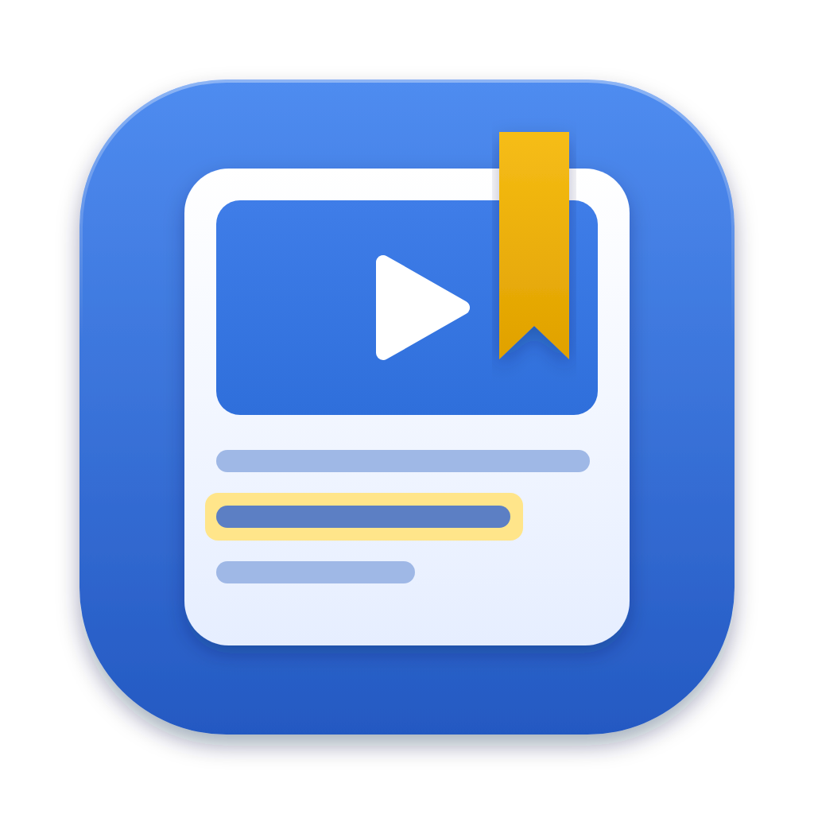
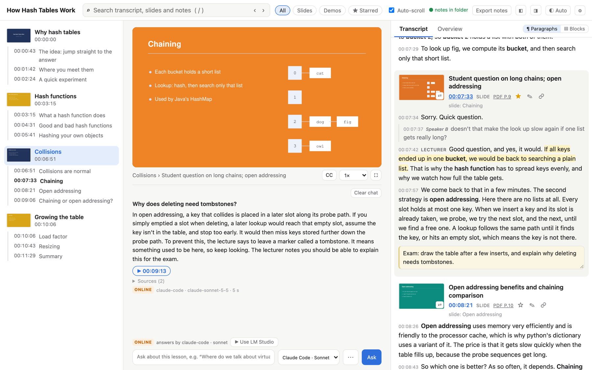
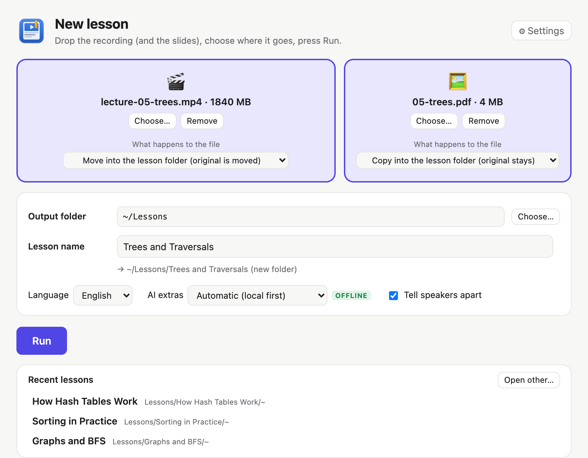
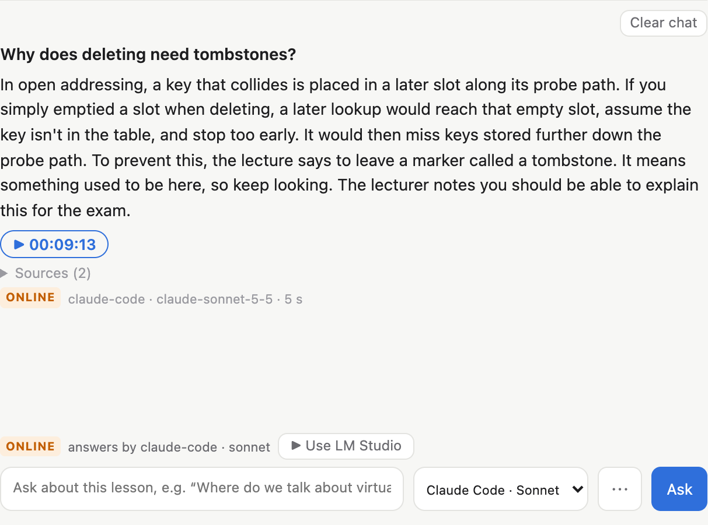
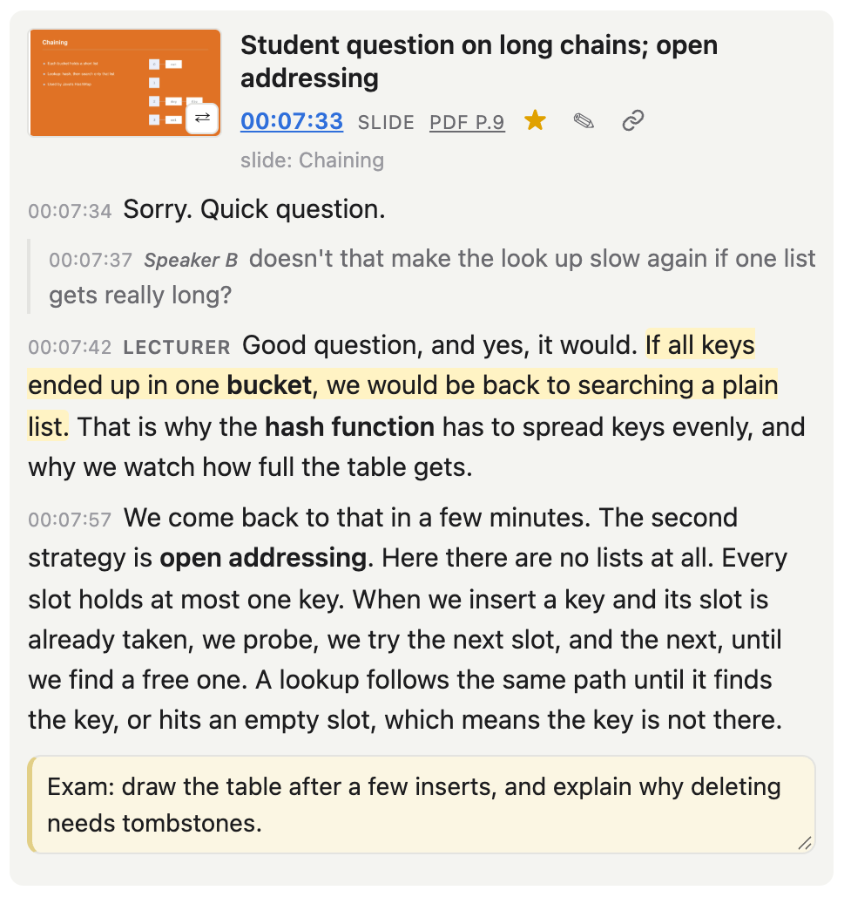
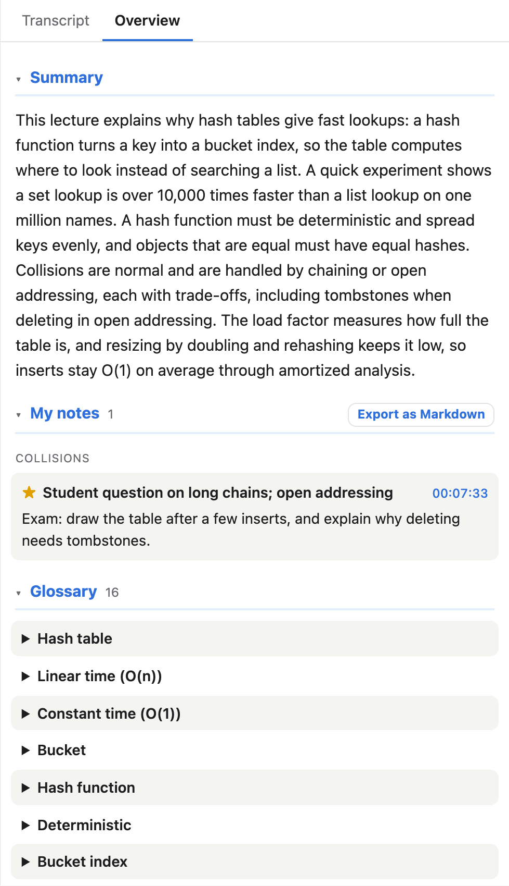
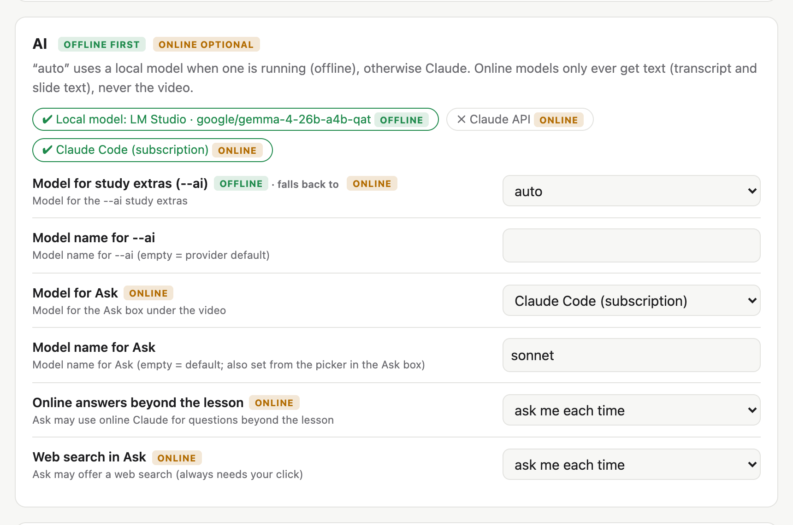

# afterclass

**Lecture recording in, searchable study page out. Offline first.**

Drop in a lecture video (and the slides), get one page per lesson: chapters with slide pictures, the video, a
clickable transcript, your stars and notes, a summary and a glossary, and an Ask box that answers from the lecture.
Everything runs on your Mac; online AI is optional and only ever gets text.



<sub>Screenshots show a made-up demo lecture (`docs/make_demo.py`), not a real class.</sub>

## A quick tour

### Make a lesson



Open **AfterClass.app**, drop the recording and (optionally) the slides, pick the output folder and press **Run**.
A 2.5 h lecture takes about 10 minutes on an M2 Pro, plus the AI step. Then **Open lesson**. Earlier lessons are listed under **Recent lessons**.

Prefer the Terminal? `afterclass lesson.mp4 lesson-01/ --deck slides.pdf --ai` does the same
(see [Technical details](#technical-details)).

**With the slides** (PDF or PowerPoint) you get sharp slide pictures, exact slide text and chapters from the deck.
**With AI** (a local model or Claude) you also get chapter names, a short title per part, a summary and a glossary.

<br clear="right">

### Chapters (left)

One slide picture per chapter, with the subchapters (slide titles, long live demos) below it. Click to jump. The
chapter that is playing is highlighted.

### The video and its tools

Under the video: where you are (**chapter › part**), **CC** for subtitles, the **speed** (0.5–2×, remembered) and
**fullscreen** (or double-click the video). Space plays and pauses.

### Ask (under the video)



Ask anything about the lecture. A model reads the matching parts and answers in its own words, with a **▶ button to
the main moment** and the other places as **Sources**. A local model (LM Studio or Ollama) is used first and works
offline; one click on **▶ Use LM Studio** (or **▶ Start**) switches to it. Claude only gets text, and by default the page asks before
anything goes online. Pick the model next to the box, **⋯** adds more models, **Clear chat** starts over.

<br clear="right">

### Transcript (right)



One part per slide or screen, with its picture, a short title, the time and the deck page (**PDF p. 9** opens it).
Click any sentence to jump there; the line that is playing is highlighted. Other voices, such as questions from the
audience, are indented and marked.

- **☆** star a part, **✎** write a note under it, **🔗** copy a link to this moment.
- **⇄** on the picture switches between the slide and the real video frame; click the picture to enlarge it.
- **¶ Paragraphs** splits each part at speaker changes and pauses, with a time per paragraph.
  **▤ Blocks** shows each part as one block of text.

<br clear="right">

### Overview (the tab next to Transcript)



Easy to miss, worth a look before an exam: the **summary** of the lecture, **all your stars and notes** grouped by
chapter (**Export as Markdown**), and the **glossary** with a jump to where each term comes up.

<br clear="right">

### Top bar

- **Search** (`/`) looks through the transcript, the slide text and your notes. `Enter` / `Shift+Enter` or **‹ ›** go
  to the next and previous hit, `Esc` clears it.
- **All · Slides · Demos · ★ Starred** filter the transcript, for example to only the parts you starred.
- **Auto-scroll** keeps the chapters and the transcript on what is playing. Turn it off to read ahead.
- **notes in folder** (green) means your stars and notes are saved in the lesson folder.
- **Export notes** downloads your stars and notes as Markdown.
- **◧ ◨** hide the chapters or the transcript for a bigger video (`[` `]`); drag the edges between the lanes to
  resize them. Then the **theme** (Auto, Light, Dark) and **⚙** for the settings.
- Click the **lesson title** to rename it.

### Settings



**⚙** opens the settings for all lessons: defaults for new lessons (language, slide sensitivity, speech model, what
happens to the files), which model to use for the study extras and for Ask, **Local AI** (start LM Studio or Ollama, pick a
model) and the **Claude API key** (stored in the macOS Keychain). The AI options are tagged **offline** or **online**, so you
always see what stays on your Mac.

<br clear="right">

### Keyboard shortcuts

| Key | | Key | |
|---|---|---|---|
| `Space` | play / pause | `/` | search |
| `j` / `k` | next / previous part | `a` | ask |
| `s` | star the current part | `n` | note on the current part |
| `c` | subtitles | `f` | fullscreen |
| `<` / `>` | slower / faster | `[` / `]` | hide chapters / transcript |

## What runs where

| Step | Where |
|---|---|
| Transcription (Whisper), speakers, slide detection, OCR, deck matching, chapters from slides | **on your Mac**, offline |
| The page, search, notes | **on your Mac**, offline |
| `--ai` and Ask with a **local model** (LM Studio / Ollama) | **on your Mac**, offline |
| `--ai` and Ask with **Claude** (`claude-code` = your subscription, `claude` = API key) | online: only text is sent (transcript + slide text), never the video |

`--ai` and Ask use the local model first when one is running. Ask only goes online after you click (and asks first if that's set in the settings).

## Technical details

### Install (macOS, Apple Silicon)

```bash
brew install ffmpeg tesseract uv
git clone https://github.com/icybermonkey/afterclass.git ~/Projects/afterclass
uv tool install --python 3.14 --editable "$HOME/Projects/afterclass[claude]"
afterclass --help
afterclass install-app   # optional: AfterClass.app in /Applications (remove: afterclass install-app --remove)
```

`--editable` means code changes in the repo apply immediately. After a change to the dependencies, run the same command with `--reinstall`.
For German OCR: `brew install tesseract-lang`. `.pptx` decks need LibreOffice (`brew install --cask libreoffice`), or export them to PDF yourself.

### The Mac app

`afterclass install-app` puts **AfterClass.app** into /Applications. Lessons and the settings open as windows of the
app (File → Open Lesson… for earlier ones), and it shows up as **AfterClass** in the Dock. `afterclass app` opens the
same window from the Terminal. With the app installed, a page you double-clicked (`index.html`) has an **Open in
AfterClass** button that reopens it in the app (notes in the folder, all Ask models). Installing needs clang (Xcode
command line tools: `xcode-select --install`); after a Python upgrade run `afterclass install-app` again.

### The lesson folder

```bash
afterclass lesson.mp4 lesson-01/ --deck slides.pdf --ai   # build the page
afterclass open lesson-01/                                # study: notes saved in the folder, Ask, settings
```

One self-contained folder per lesson, so it syncs well to a cloud drive or file share:

```
lesson-01/
  index.html      ← the page (also works straight from the folder, without `afterclass open`)
  media/          the video (copied by default) and the deck PDF
  slides/         one frame per slide change
  deck/           sharp renders of the deck pages
  data/           transcript, scenes, OCR, speakers, AI results, lesson.json (generated, can be rebuilt)
  notes/          your stars, notes, speaker names and Ask history (never touched by a rebuild)
```

### Usage

```bash
afterclass <video> <output-folder> [options]

  --deck FILE           slide deck (.pdf/.pptx): sharp slides, exact text, chapters
  --title TEXT          page title (default: file name)
  -l LANG               spoken language (default en)
  -t NUM                slide-change sensitivity, higher = fewer cards (default 4)
  -w                    word timestamps + extra hallucination filter (slower)
  --speakers / --no-speakers   tell speakers apart (default on)
  --ai [PROVIDER]       chapter names + glossary: local, claude-code (subscription), claude (API key); default: local first
  --ai-model MODEL      e.g. claude-sonnet-5-5, sonnet for claude-code, or a local model name
  -y                    don't ask before paid API calls
  --redo STEP           redo one step: transcribe, speakers, scenes, ocr, deck, ai (repeatable)
  -f                    redo everything (your notes/ are kept)
  --copy | --link | --move   how the recording gets into media/ (default: move, see settings)
  --deck-mode MODE      the same for the slides: copy, link or move (default: copy)
  --open                open the page with `afterclass open` when done

afterclass app               a window: drop the video (+ slides), pick the output folder, Run
afterclass install-app       AfterClass.app in /Applications (opens `afterclass app`); --remove deletes it
afterclass open <folder>     the page with notes saved in the folder, Ask and settings (local server, this Mac only)
afterclass settings          global settings in the browser
afterclass setup ai          guided local AI setup
afterclass auth set|status|remove claude    Claude API key in the macOS Keychain
afterclass config show|set|path             settings in the terminal
```

Steps are cached in `data/`, so a rerun only redoes what you ask for, e.g. `afterclass lesson.mp4 out/ -t 2 --redo scenes` for more cards.

Timing for a 2.5 h lecture on an M2 Pro: transcript ~5 min, speakers ~25 s, slides ~3.5 min, OCR ~20 s.

### What `--ai` adds

Without AI you get the transcript, slides, search and notes, plus chapters *if the slides have section pages*.
`--ai` (a local model or Claude) adds **chapter names for every lesson**, a **quick title for every part**, a **summary** and a **glossary**.
Ask always needs a model: local (offline, `afterclass setup ai`) or Claude (online, only text is sent).

**Ask without `afterclass open`** (when you just double-click `index.html`): the page talks to LM Studio or Ollama directly
if they allow browser pages. Allow it once with `afterclass setup ai`, or yourself:
`lms server stop && lms server start --cors` (lets any website use your local model, not your files; to keep it after a
restart: LM Studio → Developer → Server Settings → Enable CORS) or, for Ollama,
`launchctl setenv OLLAMA_ORIGINS null && brew services restart ollama`. Notes then stay in that browser; with
`afterclass open` they are saved in the lesson folder and Claude online is available too.

### Local AI in 5 minutes

```bash
afterclass setup ai
```

The wizard finds LM Studio or Ollama and recommends a model for your Mac's memory (32 GB → a ~14B model). It shows each command and **asks before every download or start**, then tests the model and saves the choice. It works the same from the ⚙ settings page. By hand with LM Studio:

```bash
lms server start
lms get qwen/qwen3-14b                                   # ~9 GB, once
lms load qwen/qwen3-14b --context-length 32768 -y        # enough context for a whole lecture
```

If a model's context is too small for a lecture, afterclass works in parts and merges the result.

### Settings, keys and notes

- **Settings** are global for all lessons, in `~/.config/afterclass/config.toml`. They are edited with `afterclass settings` (browser) or `afterclass config`. They are kept outside the installed tool on purpose, so upgrades and reinstalls don't wipe them. `AFTERCLASS_CONFIG=/path/config.toml` moves them.
- **API keys** live in the macOS Keychain (`afterclass auth set claude`, or the settings page). They are never written to a file, a lesson folder or a log. An `ANTHROPIC_API_KEY` environment variable or an `ant auth login` profile also works.
- **Notes**: with `afterclass open`, they are saved in `<lesson>/notes/notes.json` (atomic writes, cloud-sync friendly) and appear in every window. Opened straight from the folder (`file://`), the page keeps notes in that browser and shows the folder's notes from the last build.

`afterclass open` runs a small server on `127.0.0.1` only. It refuses other hosts and origins, and the API needs a header other websites can't send.

### AI providers

| Provider | Needs | Cost |
|---|---|---|
| `local` | LM Studio or Ollama running with a model (`afterclass setup ai`) | free, offline |
| `claude-code` | the [Claude Code](https://claude.com/claude-code) CLI, logged in | included in your Claude subscription (uses its limits) |
| `claude` | an API key from console.anthropic.com | pay per use, ≈ $0.30–0.40 per 2.5 h lecture (Claude Opus 5.5) |

Lectures on security topics can occasionally trip a model's safety filter. afterclass then reports it and never shows a placeholder answer. The `claude` API provider automatically falls back to another model.

### How it works

1. **ffprobe** checks the input. **ffmpeg silencedetect** finds breaks, and cards are cut around them so breaks fold away.
2. **mlx-whisper** (large-v3-turbo) transcribes on the GPU, with a filter for typical Whisper hallucinations.
3. **SpeechBrain ECAPA** voice fingerprints (on the Apple GPU) separate the lecturer from other voices.
4. **PySceneDetect** finds slide changes. **tesseract** reads each frame: titles, "Page X of N", section slides, and macOS menu bars (= live demo).
5. With `--deck`, **PyMuPDF** reads the deck, and frames are matched to pages by page number or text similarity.
6. Cards, paragraphs, chapters (picture + subchapters) and speakers go into `data/lesson.json`, which is embedded in `index.html`.
7. Ask uses BM25 search over paragraphs, slides and the glossary, then a model that answers from those passages. For "where does X start" questions, the earliest strong match sets the ▶ moment.

### Project layout

```
src/afterclass/
  cli.py            commands and options
  model.py          source-neutral Lesson model (the page only reads this)
  sources/          input types: video (now); audio, pdf, pptx are registered as planned
  steps/            probe, transcribe, silence, speakers, scenes, ocr, deck, analyze, ai, render
  ai/               provider interface + local, claude (API), claude_code (subscription)
  ask.py            offline search + answers for the Ask tab
  server.py         `afterclass open` / `afterclass settings`
  setup_ai.py       `afterclass setup ai`
  web/              template.html (the page), settings.html
```

**Adding an input type**: write `sources/<type>.py` that builds a `Lesson`, then register it in `sources/registry.py`.
**Adding an AI provider** (OpenAI, Gemini, …): write `ai/<name>.py` implementing `ai/base.py:Provider`, then list it in `ai/registry.py`.

### Rename the tool

The command name is in two places: `[project.scripts]` in `pyproject.toml` and `APP_NAME` in `src/afterclass/__init__.py`. To also rename the package, `git mv src/afterclass src/<new>` and update the imports and `packages` in `pyproject.toml`. Then run `uv tool install --editable . --reinstall`.

### Development

```bash
uv sync
uv run pytest            # no network, no keys; AI providers are tested against fakes
```

If the repo lives in iCloud Drive, keep the virtualenv out of sync: `mkdir .venv.nosync && ln -s .venv.nosync .venv`. Otherwise iCloud hides files inside it and imports break.

### Notes

- mlx-whisper runs on Apple Silicon only. Other platforms would need a different transcriber (e.g. faster-whisper) behind `steps/transcribe.py`.
- Generated lesson folders can contain webcam frames of classmates. Share the tool, not the lessons.

## License

AfterClass is licensed under the [GNU AGPL v3.0 or later](LICENSE). It uses PyMuPDF, which is AGPL as well.
